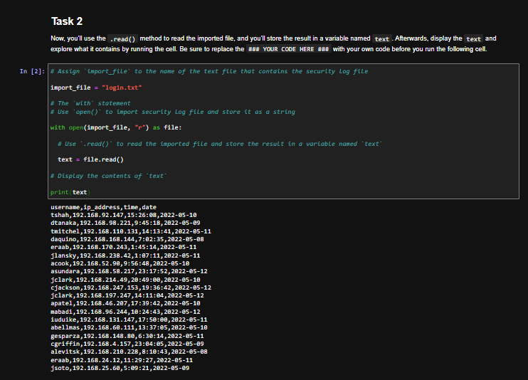
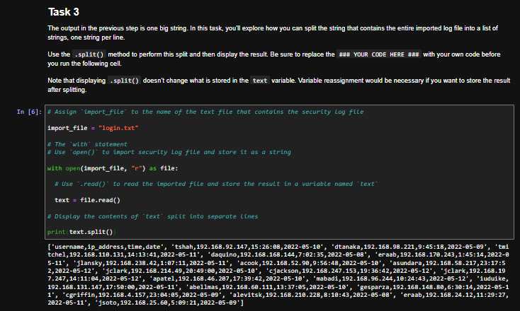
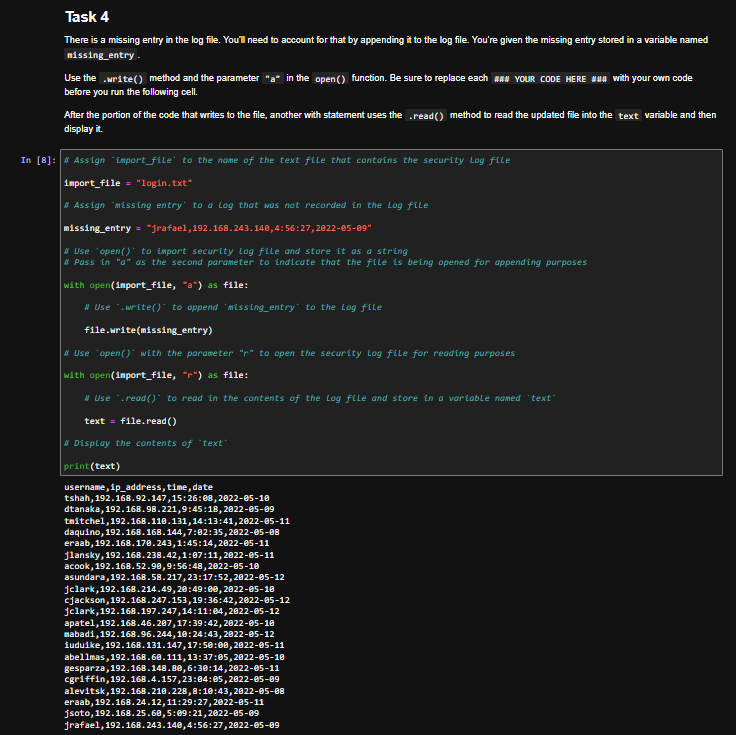
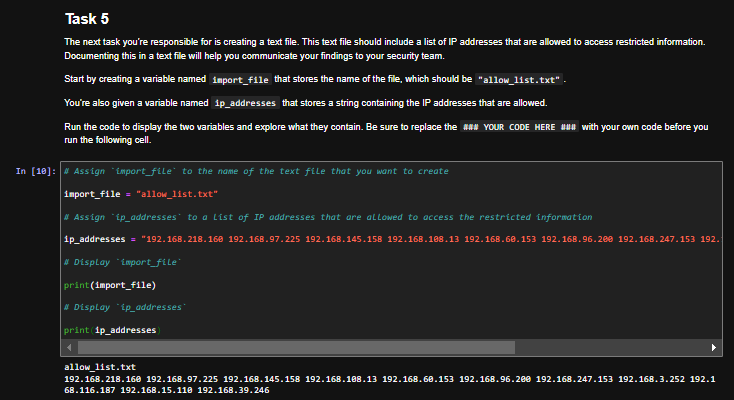
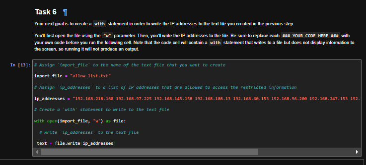
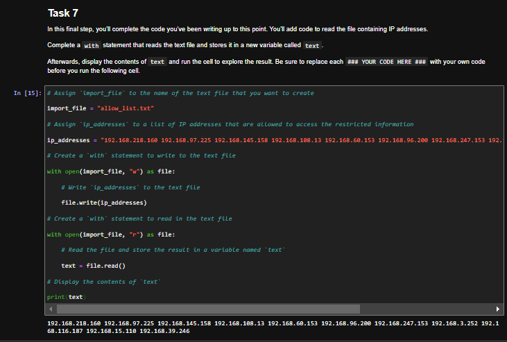

# Python File Import and Parsing: Reading a Login Log and Writing an Allow List

## Summary

In this lab from the Google Cybersecurity Certificate (Automate Cybersecurity Tasks with Python), I used Python to import and parse a text file. I read a login log, split it into individual entries, appended a missing log line, and created a new file that stores a list of allowed IP addresses. The usernames, timestamps, and IP addresses are sample data provided by the course.

## Tools Used

- Python 3
- Jupyter Notebook (course lab environment)

## Skills Demonstrated

- Opening files with a `with` statement and `open()`
- Reading, writing, and appending with the `"r"`, `"w"`, and `"a"` modes
- Reading a file into a string with `.read()`
- Writing a string to a file with `.write()`
- Splitting a string into a list with `.split()`

## Part 1: Reading and Updating a Login Log

The first part of the lab works with a security log stored in `login.txt`. Each line has a username, an IP address, a login time, and a date, separated by commas.

**Task 1: open the log file.** I assigned the filename to `import_file` and started a `with` statement that opens it in read mode (`"r"`). The `as file:` part names the opened file object so later methods can use it. This cell only sets up the `with` statement, so the body is added in the next task.

```python
import_file = "login.txt"

with open(import_file, "r") as file:
```

**Task 2: read the file and display it.** Inside the `with` block, `.read()` pulls the entire file into a string named `text`. `print(text)` sits outside the `with` block, so it runs after the file is closed. The output is the full log as one string, starting with the header `username,ip_address,time,date`. The first data line is `tshah,192.168.92.147,15:26:08,2022-05-10`.

```python
import_file = "login.txt"

with open(import_file, "r") as file:
    text = file.read()

print(text)
```



**Task 3: split the log into a list.** The log is still one big string. `.split()` with no arguments splits on any whitespace, including the newlines between log entries. Because the fields on each line are separated by commas rather than spaces, each log line stays intact as one list item. `print(text.split())` displays a list in square brackets, with each entry in quotes and separated by commas. Calling `.split()` does not change `text` itself.

```python
import_file = "login.txt"

with open(import_file, "r") as file:
    text = file.read()

print(text.split())
```



**Task 4: append a missing entry.** A login that was not recorded is stored in `missing_entry`. Opening the file with `"a"` appends to the end instead of overwriting what is already there. `file.write(missing_entry)` adds that line to `login.txt`. A second `with` statement reopens the file with `"r"`, reads the updated contents into `text`, and prints them. `jrafael,192.168.243.140,4:56:27,2022-05-09` now appears as the last line of the log.

```python
import_file = "login.txt"

missing_entry = "jrafael,192.168.243.140,4:56:27,2022-05-09"

with open(import_file, "a") as file:
    file.write(missing_entry)

with open(import_file, "r") as file:
    text = file.read()

print(text)
```



## Part 2: Creating an IP Allow List File

The second part creates a new text file that documents IP addresses allowed to access restricted information, so the findings can be shared with a security team.

**Task 5: assign the filename and the IP list.** `import_file` is set to `"allow_list.txt"`. `ip_addresses` is a string of allowed IP addresses separated by spaces. Printing both variables shows the filename and the full list of addresses.

```python
import_file = "allow_list.txt"

ip_addresses = "192.168.218.160 192.168.97.225 192.168.145.158 192.168.108.13 192.168.60.153 192.168.96.200 192.168.247.153 192.168.3.252 192.168.116.187 192.168.15.110 192.168.39.246"

print(import_file)
print(ip_addresses)
```



**Task 6: write the IP addresses to the file.** A `with` statement opens `allow_list.txt` in write mode (`"w"`), which creates the file if it does not already exist. `file.write(ip_addresses)` writes the string to the file. I assigned the return value of `.write()` to `text`; that value is the number of characters written, and assigning it is not required. The cell does not print anything, which is expected for this step.

```python
import_file = "allow_list.txt"

ip_addresses = "192.168.218.160 192.168.97.225 192.168.145.158 192.168.108.13 192.168.60.153 192.168.96.200 192.168.247.153 192.168.3.252 192.168.116.187 192.168.15.110 192.168.39.246"

with open(import_file, "w") as file:
    text = file.write(ip_addresses)
```



**Task 7: read the allow list back.** The same notebook cell also includes a second `with` statement that reopens the file with `"r"`. `text = file.read()` stores the file contents, and `print(text)` displays the same IP addresses that were written in Task 6, confirming the file was created correctly.

```python
import_file = "allow_list.txt"

ip_addresses = "192.168.218.160 192.168.97.225 192.168.145.158 192.168.108.13 192.168.60.153 192.168.96.200 192.168.247.153 192.168.3.252 192.168.116.187 192.168.15.110 192.168.39.246"

with open(import_file, "w") as file:
    file.write(ip_addresses)

with open(import_file, "r") as file:
    text = file.read()

print(text)
```



## Key Takeaways

- A `with` statement and `open()` open a file and close it automatically when the block ends.
- The second argument to `open()` is the mode: `"r"` reads, `"w"` writes (and creates the file if needed), and `"a"` appends to the end without overwriting existing content.
- `.read()` returns the entire file as a single string.
- `.split()` with no arguments splits on whitespace, including newlines, so a multi-line log becomes a list with one string per line. It does not modify the original string.
- `.write()` writes a string to the file and returns the number of characters written.
- After appending or writing, reopening the file in `"r"` mode and printing `.read()` is a way to confirm the update.
- These file operations are a practical way to work with security logs and allow lists: import the data, parse it, add missing entries, and save results for the team.
