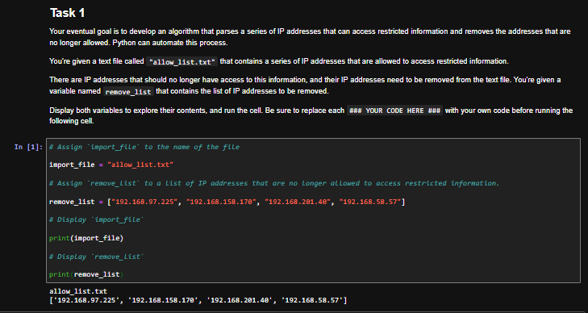
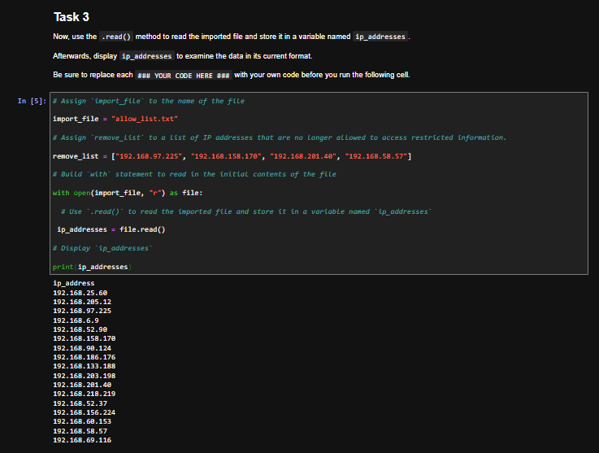
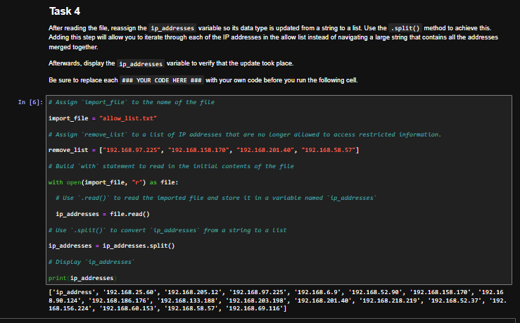
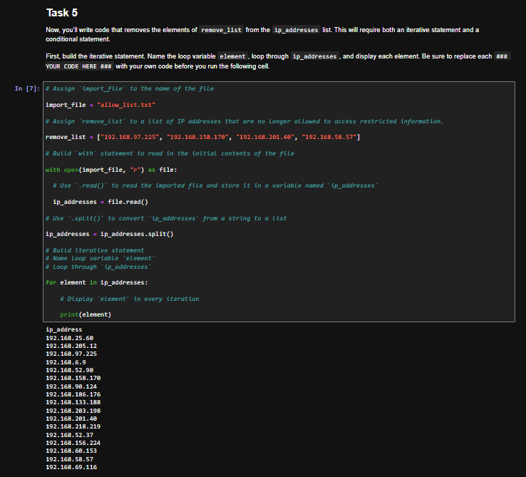
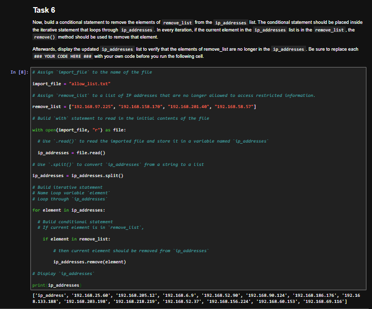
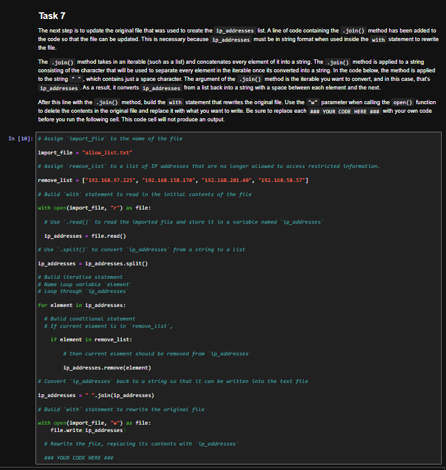
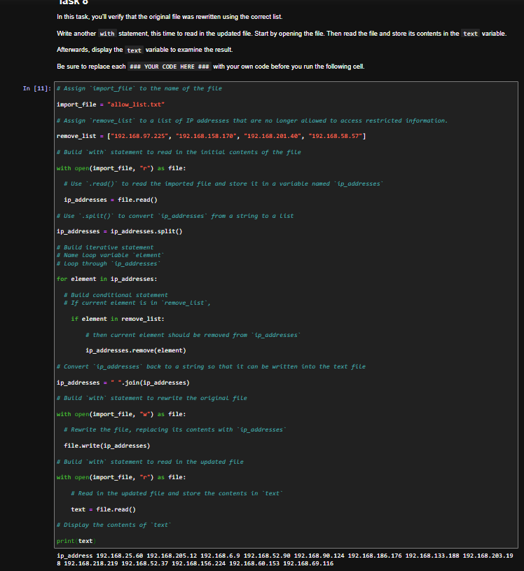
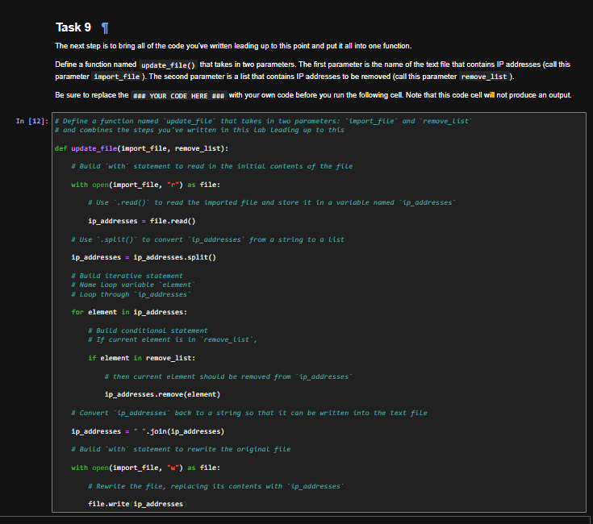
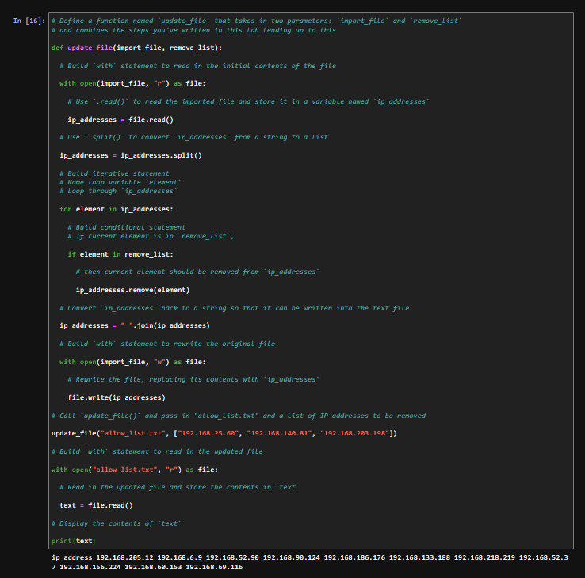

# Python Update a File Through an Algorithm: Removing IP Addresses from an Allow List

## Summary

In this lab from the Google Cybersecurity Certificate (Automate Cybersecurity Tasks with Python), I wrote a Python algorithm that updates a file. I read a list of allowed IP addresses from `allow_list.txt`, removed addresses that should no longer have access, wrote the updated list back to the file, and then wrapped those steps in a reusable `update_file()` function. The IP addresses are sample data provided by the course.

## Tools Used

- Python 3
- Jupyter Notebook (course lab environment)

## Skills Demonstrated

- Opening files with a `with` statement and `open()`
- Reading and writing with the `"r"` and `"w"` modes
- Reading a file into a string with `.read()`
- Writing a string to a file with `.write()`
- Splitting a string into a list with `.split()` and joining a list back into a string with `.join()`
- Looping through a list with a `for` loop
- Removing list elements with a conditional and `.remove()`
- Defining and calling a function with parameters

## Part 1: Reading, Filtering, and Updating the Allow List

The lab works with `allow_list.txt`, a text file of IP addresses that are allowed to access restricted information. A second list, `remove_list`, holds addresses that should no longer have access and need to be taken out of the file.

**Task 1: assign the filename and the removal list.** I assigned `"allow_list.txt"` to `import_file` and assigned the four addresses that had lost access to `remove_list`. Printing both variables shows the filename and the list `['192.168.97.225', '192.168.158.170', '192.168.201.40', '192.168.58.57']`.

```python
import_file = "allow_list.txt"

remove_list = ["192.168.97.225", "192.168.158.170", "192.168.201.40", "192.168.58.57"]

print(import_file)
print(remove_list)
```



**Task 2: open the allow list file.** I started a `with` statement that opens `import_file` in read mode (`"r"`). The `as file:` part names the opened file object so later methods can use it. This cell only sets up the `with` statement, so running it produces an `Unexpected EOF while parsing` error until the next task adds the body. That error is expected at this step.

```python
import_file = "allow_list.txt"

remove_list = ["192.168.97.225", "192.168.158.170", "192.168.201.40", "192.168.58.57"]

with open(import_file, "r") as file:
```

**Task 3: read the file and display it.** Inside the `with` block, `.read()` pulls the entire file into a string named `ip_addresses`. `print(ip_addresses)` sits outside the `with` block, so it runs after the file is closed. The output is the full allow list as one string, starting with the header `ip_address`. The first address is `192.168.25.60`.

```python
import_file = "allow_list.txt"

remove_list = ["192.168.97.225", "192.168.158.170", "192.168.201.40", "192.168.58.57"]

with open(import_file, "r") as file:
    ip_addresses = file.read()

print(ip_addresses)
```



**Task 4: split the string into a list.** The allow list is still one big string, which is hard to edit address by address. `.split()` with no arguments splits on any whitespace, including the newlines between addresses, and I reassigned that result back to `ip_addresses`. `print(ip_addresses)` now shows a list in square brackets, with each address in quotes and separated by commas.

```python
import_file = "allow_list.txt"

remove_list = ["192.168.97.225", "192.168.158.170", "192.168.201.40", "192.168.58.57"]

with open(import_file, "r") as file:
    ip_addresses = file.read()

ip_addresses = ip_addresses.split()

print(ip_addresses)
```



**Task 5: loop through the addresses.** A `for` loop walks through `ip_addresses` one element at a time, using `element` as the loop variable. `print(element)` displays each IP address on its own line, including the `ip_address` header and the four addresses that will be removed in the next task.

```python
import_file = "allow_list.txt"

remove_list = ["192.168.97.225", "192.168.158.170", "192.168.201.40", "192.168.58.57"]

with open(import_file, "r") as file:
    ip_addresses = file.read()

ip_addresses = ip_addresses.split()

for element in ip_addresses:
    print(element)
```



**Task 6: remove the addresses that lost access.** Inside the same loop, a conditional checks whether the current `element` is in `remove_list`. If it is, `.remove()` takes that address out of `ip_addresses`. After the loop, `print(ip_addresses)` shows the updated list. `192.168.97.225`, `192.168.158.170`, `192.168.201.40`, and `192.168.58.57` are no longer in it.

```python
import_file = "allow_list.txt"

remove_list = ["192.168.97.225", "192.168.158.170", "192.168.201.40", "192.168.58.57"]

with open(import_file, "r") as file:
    ip_addresses = file.read()

ip_addresses = ip_addresses.split()

for element in ip_addresses:
    if element in remove_list:
        ip_addresses.remove(element)

print(ip_addresses)
```



**Task 7: join the list and write it back to the file.** `" ".join(ip_addresses)` turns the list back into a single string with a space between each address, which is the format `.write()` needs. A second `with` statement opens the original file in write mode (`"w"`) and `file.write(ip_addresses)` replaces the file contents with that updated string. The cell does not print anything, which is expected for this step.

```python
import_file = "allow_list.txt"

remove_list = ["192.168.97.225", "192.168.158.170", "192.168.201.40", "192.168.58.57"]

with open(import_file, "r") as file:
    ip_addresses = file.read()

ip_addresses = ip_addresses.split()

for element in ip_addresses:
    if element in remove_list:
        ip_addresses.remove(element)

ip_addresses = " ".join(ip_addresses)

with open(import_file, "w") as file:
    file.write(ip_addresses)
```



**Task 8: read the file back to confirm the update.** A third `with` statement reopens `allow_list.txt` with `"r"`. `text = file.read()` stores the file contents, and `print(text)` displays the updated allow list as a space-separated string. The four addresses from `remove_list` are gone from the file.

```python
import_file = "allow_list.txt"

remove_list = ["192.168.97.225", "192.168.158.170", "192.168.201.40", "192.168.58.57"]

with open(import_file, "r") as file:
    ip_addresses = file.read()

ip_addresses = ip_addresses.split()

for element in ip_addresses:
    if element in remove_list:
        ip_addresses.remove(element)

ip_addresses = " ".join(ip_addresses)

with open(import_file, "w") as file:
    file.write(ip_addresses)

with open(import_file, "r") as file:
    text = file.read()

print(text)
```



## Part 2: Wrapping the Algorithm in a Function

The second part turns the steps from Part 1 into a function so the same algorithm can be reused with a different file or a different removal list.

**Task 9: define `update_file()`.** I defined `update_file(import_file, remove_list)` with two parameters: the name of the text file and the list of addresses to remove. The function body combines the earlier steps: read the file, split it into a list, remove any address that appears in `remove_list`, join the list back into a string, and write that string to the file. This cell only defines the function, so it does not produce output.

```python
def update_file(import_file, remove_list):

    with open(import_file, "r") as file:
        ip_addresses = file.read()

    ip_addresses = ip_addresses.split()

    for element in ip_addresses:
        if element in remove_list:
            ip_addresses.remove(element)

    ip_addresses = " ".join(ip_addresses)

    with open(import_file, "w") as file:
        file.write(ip_addresses)
```



**Task 10: call the function and verify the file.** I called `update_file()` with `"allow_list.txt"` and a new removal list, `["192.168.25.60", "192.168.140.81", "192.168.203.198"]`. A `with` statement then reopens the file with `"r"`, stores the contents in `text`, and prints them. `192.168.25.60` and `192.168.203.198` are no longer in the file. (`192.168.140.81` was not in the updated list from Task 8.)

```python
def update_file(import_file, remove_list):

    with open(import_file, "r") as file:
        ip_addresses = file.read()

    ip_addresses = ip_addresses.split()

    for element in ip_addresses:
        if element in remove_list:
            ip_addresses.remove(element)

    ip_addresses = " ".join(ip_addresses)

    with open(import_file, "w") as file:
        file.write(ip_addresses)

update_file("allow_list.txt", ["192.168.25.60", "192.168.140.81", "192.168.203.198"])

with open("allow_list.txt", "r") as file:
    text = file.read()

print(text)
```



## Key Takeaways

- A `with` statement and `open()` open a file and close it automatically when the block ends. Use `"r"` to read and `"w"` to overwrite the file with new contents.
- `.read()` returns the entire file as a single string. `.split()` with no arguments turns that string into a list of addresses, and `" ".join()` turns the list back into a space-separated string that can be written with `.write()`.
- A `for` loop can walk through each address, and a conditional with `.remove()` can take out any address that appears in a removal list.
- After writing, reopening the file in `"r"` mode and printing `.read()` is a way to confirm the update.
- Wrapping these steps in a function with parameters (`import_file` and `remove_list`) makes the same algorithm reusable for a different file or a different set of addresses.
- This is a practical way to maintain an IP allow list: import the current list, remove access that is no longer approved, and save the updated file.
