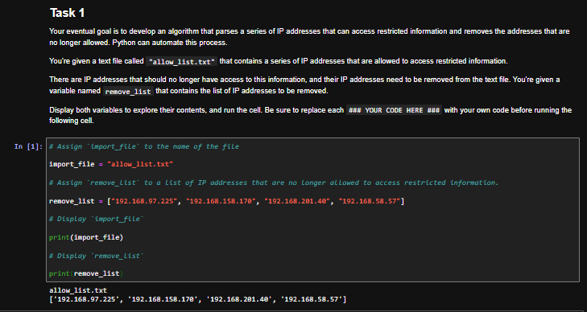
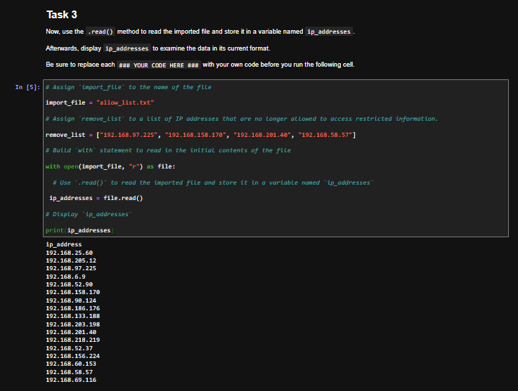
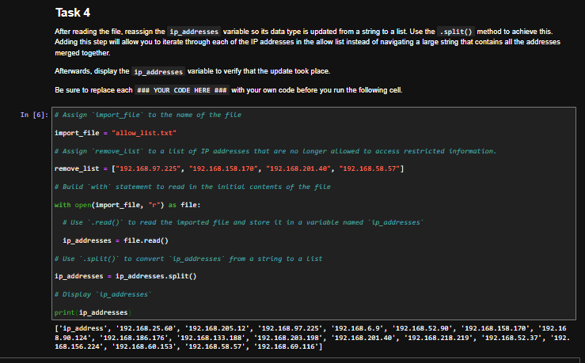
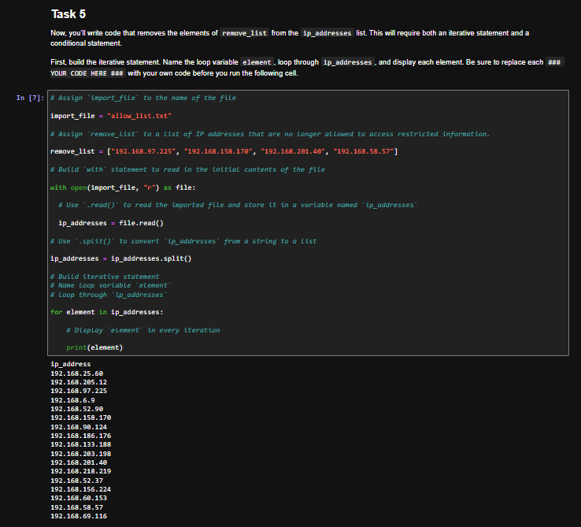
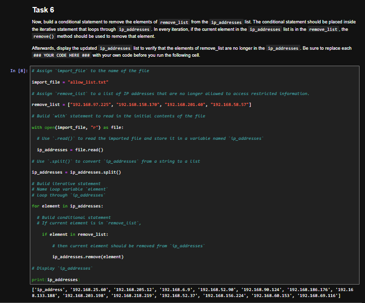
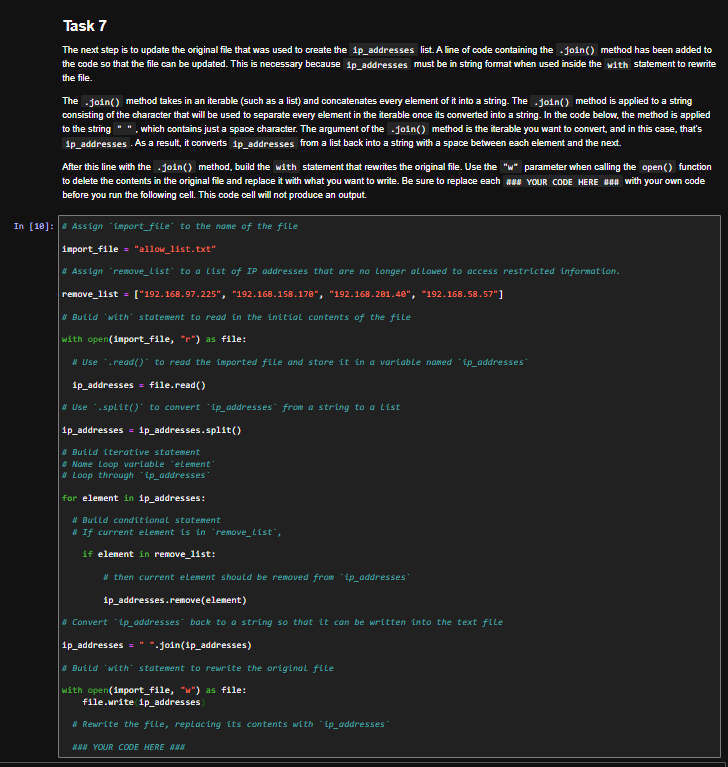
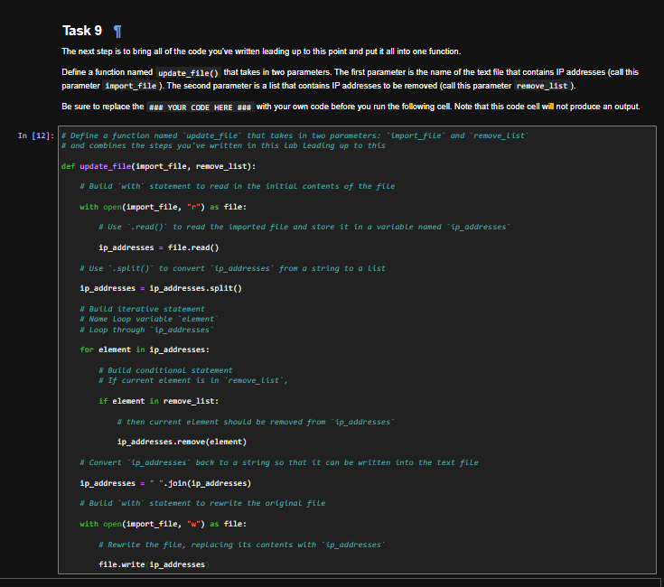
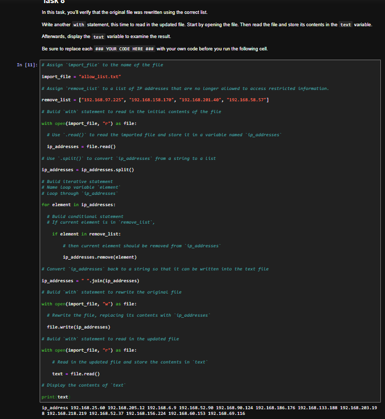
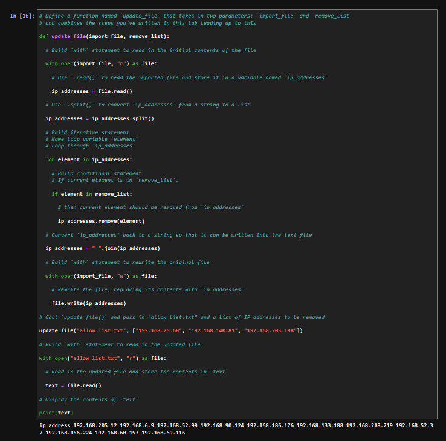

# Algorithm for file updates in Python

## Project description

This portfolio activity is from the Google Cybersecurity Certificate course Automate Cybersecurity Tasks with Python. In the lab scenario, I am a security professional at a health care company, and part of my role is maintaining the allow list that controls who can access sensitive information. Access to a restricted subnetwork that contains personal patient records is limited by employee IP address, and the permitted IP addresses are stored in a file named `allow_list.txt`. A separate remove list identifies employees who should no longer have access, and in this case it contained `192.168.97.225`, `192.168.158.170`, `192.168.201.40`, and `192.168.58.57`. The IP addresses are sample data provided by the course. To keep this file accurate without editing it by hand, I developed an algorithm in Python that opens the allow list, compares it against the remove list, removes any matching IP addresses, and then saves the updated list back to the file.

## Open the file that contains the allow list

First, I assigned the file name `"allow_list.txt"` as a string to the variable `import_file` so the file name could be reused throughout the algorithm. I also assigned the four IP addresses that should no longer have access to a list named `remove_list`, then printed both variables to confirm their values.

I then used a `with` statement together with the `open()` function to open the file. The `with` keyword manages the file resource and automatically closes the file once the code inside the `with` statement finishes running. The `open()` function takes two arguments: the first identifies the file to open (`import_file`), and the second, `"r"`, indicates that I want to open the file in read mode. The `as` keyword assigns the opened file to a variable named `file` so I can work with it inside the `with` statement. An earlier step left the `with` statement without a body, which produced an expected error, so the working code is shown in the Task 3 screenshot in the next section.

## Read the file contents

To read the contents of the allow list, I called the `.read()` method on the file object inside the `with` statement. The `.read()` method converts the contents of the file into a single string. I stored that string in a variable named `ip_addresses` so that I could organize and work with the IP addresses in the next steps of the algorithm. Printing `ip_addresses` displayed the full allow list as one string, starting with the header `ip_address`, followed by addresses such as `192.168.25.60`.

## Convert the string into a list

Next, I used the `.split()` method to convert the `ip_addresses` string into a list. By default, `.split()` separates a string wherever there is whitespace, so each IP address in the file became its own element in the list. I reassigned the result back to the `ip_addresses` variable. Converting the data into a list makes it much easier to check for and remove individual IP addresses. Printing `ip_addresses` then showed a list in square brackets, with each address as its own element.

## Iterate through the remove list

To compare the allow list with the IP addresses that need to be removed, I set up a `for` loop that iterates through `ip_addresses`. A `for` loop repeats a block of code once for each item in a sequence. The `for` keyword starts the loop, and `element` is the loop variable that holds the current IP address on each iteration. The `in` keyword tells the loop to go through each element in `ip_addresses`, one IP address at a time. I printed `element` on every iteration so I could confirm that the loop was walking through the full allow list. Looping through the allow list put me in position to check each address against the remove list in the next step.

## Remove IP addresses that are on the remove list

Inside the `for` loop, I added a conditional statement that checks whether the current `element` is in `remove_list`. The `in` operator evaluates to `True` when the IP address exists in the remove list, so only IP addresses that should be taken out of the allow list are processed. When the condition is met, I call the `.remove()` method on `ip_addresses` and pass `element` as the argument, which removes the first occurrence of that IP address from the list. Applying `.remove()` this way works because there are no duplicate IP addresses in the `ip_addresses` list, so removing the first occurrence fully removes each IP address that is on the remove list. After the loop, I printed `ip_addresses` and confirmed that `192.168.97.225`, `192.168.158.170`, `192.168.201.40`, and `192.168.58.57` were no longer in the list.

## Update the file with the revised list of IP addresses

After removing the IP addresses, I needed to save the updated allow list back to the original file. First, I used the `.join()` method to convert the `ip_addresses` list back into a string, using a space (`" "`) as the separator so that each IP address is separated by a space. I then used another `with` statement and the `open()` function, this time with `"w"` as the second argument to open the file in write mode. Write mode replaces the existing contents of the file with whatever is written to it. Finally, I called the `.write()` method on the file object and passed in `ip_addresses`, which overwrote `allow_list.txt` with the revised list of IP addresses.

To make the algorithm reusable, I then combined these steps in a function named `update_file()` that takes two parameters: `import_file`, the name of the text file that contains the allow list, and `remove_list`, the list of IP addresses to remove. The function body reads the file, splits the contents into a list, loops through `ip_addresses` to remove any address that appears in `remove_list`, joins the revised list back into a space-separated string, and writes that string to the file.

## Summary

I created an algorithm in Python that removes IP addresses on a remove list from the allow list of IP addresses permitted to access a restricted subnetwork. I started by using a `with` statement and the `open()` function in read mode, then used the `.read()` method to store the file contents as a string in the `ip_addresses` variable. I converted that string into a list with the `.split()` method so I could work with individual IP addresses. I then used a `for` loop to iterate through `ip_addresses`, and inside the loop I used a conditional statement to check whether each `element` was in `remove_list` and the `.remove()` method to remove it. Finally, I used the `.join()` method with a space as the separator to convert the list back into a string and opened the file in write mode, using the `.write()` method to replace the contents of `allow_list.txt` with the updated list.

To confirm the first update, I opened `allow_list.txt` again in read mode, stored the contents in a variable named `text`, and printed it. The four addresses from the original remove list were gone, and the remaining addresses appeared as a single space-separated string.

I also wrapped the algorithm in a function, `update_file(import_file, remove_list)`, so the same steps can be reused with a different file or a different remove list. Calling the function with `"allow_list.txt"` and a new remove list, `["192.168.25.60", "192.168.140.81", "192.168.203.198"]`, and then reading the file showed that `192.168.25.60` and `192.168.203.198` had been removed. (`192.168.140.81` was not in the allow list at that point, so there was nothing to remove for that address.)

This algorithm automates a routine but important security task, which helps keep access to patient records limited to the employees who should have it.
